<picture>
  <source media="(max-width: 600px)" srcset="./assets/editorial-hero-mobile.svg" />
  
</picture>

  
  
  
  

<!-- PROFILE-LINKS:START -->

<a href="https://github.com/paramesh-ac">GitHub @paramesh-ac</a> · <a href="https://github.com/paramesh-ac?tab=repositories">Explore my repositories</a>

<!-- PROFILE-LINKS:END -->

<strong>Open to Python Full-Stack Developer, Backend &amp; AI Engineering roles and internships.</strong>

<picture>
  <source media="(max-width: 600px)" srcset="./assets/editorial-about-mobile.svg" />
  
</picture>

I'm **Paramesh Achari**, a **Python Full-Stack AI Developer** passionate about building AI-powered applications, scalable backend services, and responsive web experiences.

- 💼 **Experience:** Python Full-Stack AI Development Intern at **Algonex IT Solutions** — developing career management platforms, Python backend workflows, REST APIs, and responsive React interfaces.
- 🎓 **Education:** **B.Tech in Electronics**, Sri Venkeswara College of Engineering, Tirupati · 2020–2024 (CGPA: 8.2/10).
- 📍 **Location:** Tirupati, India.

<picture>
  <source media="(max-width: 600px)" srcset="./assets/editorial-stack-mobile.svg" />
  
</picture>

### 🛠️ Technical Stack

- **Programming Languages:** Python, Java, JavaScript, HTML5, CSS3
- **Backend Frameworks:** FastAPI, Django, Flask, REST APIs
- **Frontend Development:** React.js, HTML5, CSS3, JavaScript
- **Databases:** PostgreSQL, MySQL, SQLite, MongoDB
- **AI & Machine Learning:** NumPy, Pandas, Scikit-learn, PyTorch, LangChain, LLMs, RAG
- **Tools & Platforms:** Git, GitHub, VS Code, PyCharm, Jupyter Notebook, Docker, Linux, AWS
- **Soft Skills:** Problem Solving, Critical Thinking, Teamwork, Communication, Leadership

---

### 🚀 Featured Projects

<a href="https://github.com/paramesh-ac">
  <picture>
    <source media="(max-width: 600px)" srcset="./assets/editorial-project-resume-analyzer-mobile.svg" />
    
  </picture>
</a>

#### 1. AI-Powered Resume Analyzer & Job Matcher
**Stack:** Python · FastAPI · React.js · PostgreSQL · LLMs
- Built an AI-powered resume analyzer that parses PDF resumes and matches candidate skills against job descriptions (achieving **85% faster matching** and **80% improvement** in alignment).
- Implemented skill-gap analysis, personalized recommendations, tailored interview preparation questions, and an interactive dashboard.
- Integrated application tracking features across **Applied**, **Interview**, **Offer**, and **Rejected** statuses.

---

<a href="https://github.com/paramesh-ac">
  <picture>
    <source media="(max-width: 600px)" srcset="./assets/editorial-project-document-chatbot-mobile.svg" />
    
  </picture>
</a>

#### 2. AI Document Chatbot Using RAG
**Stack:** Python · FastAPI · React.js · LangChain · RAG
- Built a document-based chatbot that answers questions about uploaded PDFs using Retrieval-Augmented Generation (RAG).
- Implemented document chunking, embedding generation, and semantic search (improving retrieval accuracy by **80%**).
- Integrated source-cited AI responses, conversation history tracking, and multi-document support with FastAPI endpoints and a React frontend.

---

<a href="https://github.com/paramesh-ac">
  <picture>
    <source media="(max-width: 600px)" srcset="./assets/editorial-project-career-platform-mobile.svg" />
    
  </picture>
</a>

#### 3. Full-Stack Career Management Platform (Algonex IT Solutions)
**Stack:** Python · FastAPI · React.js · SQL · REST APIs
- Developed a full-stack career platform integrating modular services: Dashboard, Resume Analyzer, Job Search, AI Assistant, Interview Preparation, Courses, and Application Tracking.
- Built responsive React.js interfaces with reusable components and form validation for clean user experiences.
- Implemented Python backend workflows and REST API endpoints for resume analysis and application lifecycle management.

---

<picture>
  <source media="(max-width: 600px)" srcset="./assets/editorial-dashboard-mobile.svg" />
  
</picture>

<!-- PROFILE-STATS:START -->
**3 public repositories · 1 follower · 0 stars on original repositories**

_Public data only. Stars exclude forked repositories. Refreshed by GitHub Actions._
<!-- PROFILE-STATS:END -->

<picture>
  <source media="(max-width: 600px)" srcset="./assets/editorial-achievements-mobile.svg" />
  
</picture>

### 📜 Certifications & Extra-Curriculars

- 🎖️ **Generative AI** — Algonex IT Solutions
- 🎖️ **Python, DBMS & OOPs** — Algonex IT Solutions
- 🎖️ **MERN Stack Developer Program** — EDU-VERSITY
- 💡 **Algonex Hackathon:** Contributed to open-source / team projects and presented project contributions at the Algonex Hackathon.
- 💻 **Hands-On Engineering:** Built multiple self-directed projects in Python, full-stack web, and applied AI.
- 🧠 **Data Structures & Algorithms:** Practiced DSA and problem solving to strengthen computer science fundamentals.

### 📈 Contribution Trail

<picture>
  <source media="(prefers-color-scheme: dark)" srcset="./assets/github-snake-dark.svg" />
  <source media="(prefers-color-scheme: light)" srcset="./assets/github-snake.svg" />
  
</picture>

<picture>
  <source media="(max-width: 600px)" srcset="./assets/editorial-connect-mobile.svg" />
  
</picture>

  <a href="https://www.linkedin.com/in/gulabi-paramesh-achari-4a4277269/">LinkedIn</a> ·
  <a href="https://github.com/paramesh-ac">GitHub</a> ·
  <a href="mailto:parameshachari10@gmail.com">Email</a> ·
  <a href="./assets/Paramesh-Resume.pdf">Résumé PDF</a>

Curious by nature. Building with purpose.

